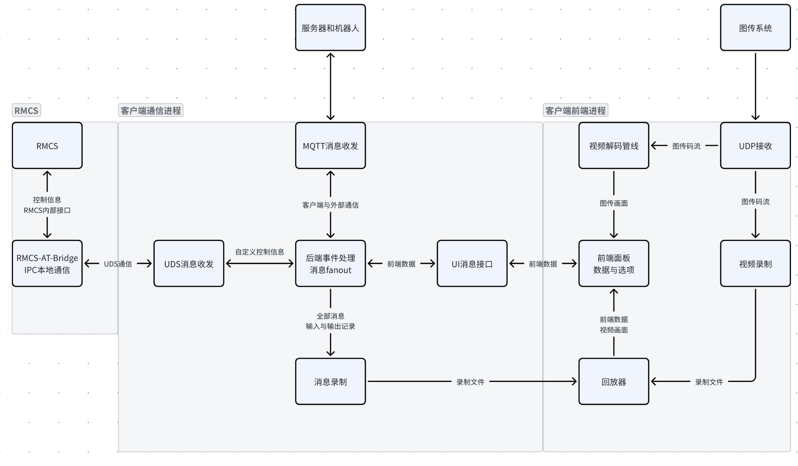

# Alliance Terminal

RoboMaster 自定义终端的操作端：把 RMCS 的控制数据经 MQTT 送进裁判系统，同时接收 HEVC 图传、显示机器人状态、录制与回放。

## 架构

系统由三个进程构成，客户端只占其中两个：

| 进程 | 归属 | 职责 |
|---|---|---|
| **RMCS**（含终端桥 [`rmcs_terminal_bridge`](https://github.com/Alliance-Algorithm/rmcs_terminal_bridge)） | 独立项目 | 控制律、安全、急停；把控制数据经 UDS 交给客户端 |
| **通信进程** `teleop-node` | 本项目 | 唯一接触 RMCS 与 MQTT 的进程；转发、录制、健康上报 |
| **前端进程** `teleop-client` | 本项目 | 视频解码显示、面板、视频录制、回放 |

三条设计原则：

- **客户端是桥**：不解释业务语义、不做安全判断、不改写 payload 字节。
- **单槽**：状态类数据只保留最新一份，拥塞时覆盖而不是排队。
- **隔离**：前端崩溃不影响控制转发与数据录制；通信进程崩溃由 systemd 拉起。

## 当前进度

- B0、B1、B5a、B2、B2b 已完成；
- I0 的 Link、组件、`launch-rmcs` 级和 60 B/600 s 延迟基线已通过；
- **I0 runtime / 桥 D5 因 RMCS 运行时控制和下游消费未完成而暂时挂起**；
- 下一阶段优先推进 B3 模拟器、B4 `teleop-node`；
- 当前延迟基线：不绑核 p50 0.137 ms、p99 0.282 ms、p99.9 0.452 ms；绑核会放大尾部；
- B5b GUI/GPU 容器尚未开始；
- 详细状态见[施工计划](docs/teleop-client-implementation-plan.md)，延迟结果见[延迟测试报告](docs/latency-test-report.md)。

## 通信结构



| 链路 | 两端 | 传输 | 内容 |
|---|---|---|---|
| **控制链路** | RMCS 终端桥 ↔ 通信进程 | UDS `SOCK_SEQPACKET`，32 字节帧头（大端） | 上行 `CustomControl`（75 Hz，≤60 B）；下行 `CustomByteBlock`（50 Hz，≤300 B） |
| **MQTT** | 通信进程 ↔ 裁判系统服务器 | MQTT 3.1.1，单连接，clientID = 机器人编号 | 9 个上行 / 23 个下行 topic；裸 protobuf；最高 QoS 1 |
| **展示链路** | 通信进程 ↔ 前端 | UDS `SOCK_SEQPACKET`，同一套帧头 | 23 路下行数据 + 健康度；前端回发 7 条指令与录制控制 |
| **图传** | 服务器 → 前端 | UDP **3334** | 8 字节大端头 + 1392 B 分片；HEVC 1080p60；无重传 |
| **录制** | 通信进程 + 前端 → 会话目录 | 文件 | `mqtt_up.pb.zst`、`mqtt_down.pb.zst`、`video/seg_*.mkv` |

Topic 固定 32 个（上行 1–9、下行 10–32），名字与官方协议一致，**不允许自造 topic**。

- 上行：`CustomControl` 走 QoS0 单槽；7 条触发性指令走 QoS1 有界队列。
- 下行：定频状态 QoS0 单槽；触发事件 QoS1 小缓冲。
- 图传包头：帧号 2 B + 分片序号 2 B + 整帧字节数 4 B（大端），后接 ≤1392 B 载荷。

字段级定义见[协议整理稿](docs/custom-terminal-protocol.md)，链路细节与决策见[架构文档](docs/teleop-client-architecture.md)。

## RMCS 终端桥

控制链路的 RMCS 侧是一个独立仓库：[`rmcs_terminal_bridge`](https://github.com/Alliance-Algorithm/rmcs_terminal_bridge)。它是 RMCS 的 ROS2 包（手动放置，不强制子模块），作为 UDS **server** 监听 `control.sock`；本项目的 `teleop-node` 作为 client 连接。

数据分三层，**客户端只搬 IPC 的 `payload` 字节，不解析官方消息**：

| 层 | 内容 | 谁组/解 |
|---|---|---|
| 数据段 | `CustomControl.data` / `CustomByteBlock.data`（0–60 / 0–300 B） | 自定义控制作者 |
| 官方 envelope | `CustomControl` / `CustomByteBlock` 的序列化字节 | 终端桥 |
| IPC envelope | `UpData` / `DownData` + 32 B 帧头 | 本项目的 `libs/teleop_ipc` 与桥共用 |

- 线格式（大端帧头、版本、session、seq、长度上限、消息号）见 [`docs/ipc-protocol.md`](docs/ipc-protocol.md)。这份文档与桥仓 `docs/ipc-protocol.md` **同内容、各存一份**，改一边必须改另一边（头部有版本/日期/正文指纹）。
- `libs/teleop_ipc` 是 Apache-2.0、header-only、自包含的库；桥仓 vendor 一份快照（Apache-2.0，保留来源/许可证），手动同步。
- 部署在 `rmcs-runtime`（root）时：宿主 socket 目录 `0700`、socket `0666`、桥 `allowed_uid=1000`、节点 `allowed_peer_uid=0`；细节见[开发容器文档](docs/teleop-client-dev-environment.md)。
- 桥自己的组件/部署/测试文档在桥仓，不随本仓库发布。

## 开发环境

开发和测试都在 Docker 里跑。镜像固定 **Ubuntu 24.04**（GCC 13 / CMake 3.28 / protobuf 3.21），CI 用同一份 Dockerfile。

### 镜像里有什么

| 阶段 | 内容 | 用途 |
|---|---|---|
| `base` | 编译工具链、protobuf、GTest、ccache、zstd | 公共底座 |
| `dev` | 加 gdb、clangd、clang-format、**zsh + oh-my-zsh**、mosquitto | 日常开发 |
| `ci` | 底座 + mosquitto | CI |

### 第一次：构建镜像

```bash
./docker/build.sh dev
```

构建默认走 host 网络，这样容器里的 `git` 能用宿主上的代理（`127.0.0.1:7890` 之类）。
oh-my-zsh 的克隆顺序是 **GitHub → gitee 镜像**；两个都不通时构建会直接失败并提示，可用
`OMZ_REPOS="https://..." ./docker/build.sh dev` 指定别的源。

### 日常：进容器

```bash
./docker/dev-shell.sh                  # 进容器，默认 zsh
./docker/dev-shell.sh -- bash -lc '…'  # 跑一次性命令
```

VS Code：装 **Dev Containers** 扩展 → `Ctrl+Shift+P` → **Reopen in Container**。
配置在 `.devcontainer/devcontainer.json`，自动用 `dev` 阶段、同路径挂载、装 clangd/CMake 扩展。

### 在容器里编译与测试

```bash
cmake --preset dev            # Debug
cmake --build --preset dev
ctest --preset dev

cmake --preset release        # 性能与延迟结论只认 Release
cmake --preset ci             # Release + -Werror
```

一条命令跑完 CI 那套：

```bash
./docker/dev-shell.sh -- bash -lc 'cmake --preset ci && cmake --build --preset ci -j"$(nproc)" && ctest --preset ci'
```

### 容器约定

| 约定 | 原因 |
|---|---|
| 源码**同路径挂载** | 容器内外是同一个绝对路径，`compile_commands.json` 和 `build/` 里的路径宿主也能用 |
| 容器用户 uid = 宿主 uid | 构建产物不会变成 root 所有 |
| 不设 CPU 配额 | cgroup 配额会造成几十毫秒停顿，对 60 fps 是致命的 |
| `/ccache` 是持久卷 | 第二次编译基本全命中 |
| 宿主与容器**别共用** `build/<preset>` | 编译器不同（GCC 15 vs 13），CMake 会拒绝复用缓存，切换时删掉重配 |

### 编辑器

```bash
ln -sfn build/dev/compile_commands.json compile_commands.json
```

`.clangd` 里也写了兜底路径；容器里构建同样适用，因为挂载路径一致。

## 本机构建（可选）

不装 Docker 也能编，需要自己装依赖：

```bash
sudo apt install cmake ninja-build g++ protobuf-compiler libprotobuf-dev libgtest-dev

cmake --preset dev && cmake --build --preset dev && ctest --preset dev
```

> 本机和容器编出来的产物不要放进同一个 `build/`（原因见上表）。

## 运行

通信进程以用户级 systemd 服务运行，前端是普通桌面程序：

```bash
systemctl --user start teleop-node
journalctl --user -u teleop-node -f

# 前台调试
./build/dev/src/node/teleop-node --config ~/.config/teleop/node.toml

# 前端
./build/dev/src/app/teleop-client
```

| 项 | 路径 |
|---|---|
| 通信进程配置 | `~/.config/teleop/node.toml` |
| 前端配置 | `~/.config/teleop/ui.toml` |
| systemd unit | `packaging/systemd/teleop-node.service` |
| socket | `~/.local/state/teleop/run/`（`rmcs/control.sock`、`ui.sock`） |
| 录制会话 | `~/.local/share/teleop/sessions/<时间戳>/` |

### IPC 探针

B2b 的 `ipc-probe` 可以单独运行：没有 RMCS 时保持 `DISCONNECTED` 并按 100 ms→2 s 退避，不会阻塞或退出。当前还没有 `teleop-node`，`ipc-probe` 是唯一可运行的客户端端点。

```bash
# 无 RMCS 自测：正常跑完并打印连接尝试/退避/最后错误
./build/dev/tools/ipc_probe/ipc-probe --duration 10 --down-hz 50 --stats

# 连真桥（rmcs-runtime 里是 root）：校验对端 uid 并跑 60 s
./build/dev/tools/ipc_probe/ipc-probe \
    --socket ~/.local/state/teleop/run/rmcs/control.sock \
    --peer-uid 0 --duration 60 --down-hz 50 --stats

# A：桥发送 → 客户端接收的单向延迟
./build/dev/tools/ipc_probe/ipc-probe \
    --socket ~/.local/state/teleop/run/rmcs/control.sock \
    --peer-uid 0 --duration 60 --latency

# C：RTT 回环；需要桥加载 TerminalTestEcho（terminal_echo_test.yaml）
./build/dev/tools/ipc_probe/ipc-probe \
    --socket ~/.local/state/teleop/run/rmcs/control.sock \
    --peer-uid 0 --duration 60 --down-hz 10 --latency --rtt

# 逐样本记录单向延迟，之后用 Python 出图
mkdir -p ~/teleop-latency
./build/dev/tools/ipc_probe/ipc-probe \
    --socket ~/.local/state/teleop/run/rmcs/control.sock \
    --peer-uid 0 --duration 600 --record ~/teleop-latency/run-001.csv

# matplotlib 依赖：Ubuntu 26.04 建议用 venv 或 apt，不要直接 --user
python3 -m venv ~/.venvs/teleop-plot
~/.venvs/teleop-plot/bin/pip install matplotlib
~/.venvs/teleop-plot/bin/python tools/plot_latency.py ~/teleop-latency/run-001.csv
```

> `--latency` 是桥发送→客户端接收的单向延迟；`--rtt` 从 `queue_down` 起算，包含客户端下行节拍和桥的 50/75 Hz 调度。
> `--record` 会为每个 `UpData` 写一行 CSV，并自动生成同名 `.meta.json`；`--record-meta PATH` 可覆盖 metadata 路径。

## 目录

```
proto/      官方协议的转录实现（Apache-2.0）
libs/       可复用头文件库：rm_proto、teleop_ipc（Apache-2.0）
src/        通信进程与前端（GPL-3.0-or-later）
tools/      IPC 探针、延迟绘图与模拟器：ipc_probe、plot_latency、teleop_sim、referee_sim（Apache-2.0）
tests/      单元 / 集成 / fuzz
docker/     开发容器
docs/       设计文档
```

## 文档

| 文档 | 内容 |
|---|---|
| [架构与选型](docs/teleop-client-architecture.md) | 三进程、链路、协议、录制、可靠性 |
| [自定义终端协议](docs/custom-terminal-protocol.md) | 官方 32 个 topic 的整理稿与实现要点 |
| [开发容器](docs/teleop-client-dev-environment.md) | 环境基线、容器参数、发布兼容性 |
| [日志规范](docs/logging.md) | `[时间][类别][模块]` 格式、模块名、记录边界 |
| [延迟测试报告](docs/latency-test-report.md) | 测量口径、工具、01–06 绑核对比与结论 |
| [IPC 协议](docs/ipc-protocol.md) | 控制链路帧格式、payload 边界、终端桥契约、rmcs-runtime 部署 |
| [施工计划](docs/teleop-client-implementation-plan.md) | 批次划分、目录、验收标准与进度追踪 |
| [AI 助手约定](Agent.md) | 提交格式、header-only、注释规则、代码与架构约束 |

## 许可证

| 目录 | 许可证 |
|---|---|
| `src/` | GPL-3.0-or-later |
| `proto/` `libs/` `tools/` `docker/` | Apache-2.0 |
| `docs/` | CC-BY-4.0 |

应用闭源保护，协议开放互通。SPDX 归属见 `REUSE.toml`。

## English

Alliance Terminal is the operator-side client for the RoboMaster custom terminal protocol.

It runs as two processes: `teleop-node` owns the only connection to RMCS (UDS) and to the referee system (MQTT 3.1.1, 32 fixed topics, raw protobuf), while `teleop-client` decodes the HEVC video feed (UDP 3334), renders telemetry, and handles recording and replay. The node is a dumb pipe: it never parses or rewrites payloads. On the RMCS side, the separate [`rmcs_terminal_bridge`](https://github.com/Alliance-Algorithm/rmcs_terminal_bridge) package is the UDS server and the only place that composes/parses the official `CustomControl` / `CustomByteBlock` envelopes; the wire format is documented in [`docs/ipc-protocol.md`](docs/ipc-protocol.md).

Development happens inside a Docker image pinned to Ubuntu 24.04: build it once with `./docker/build.sh dev`, then work in `./docker/dev-shell.sh` (zsh + oh-my-zsh) or use VS Code's "Reopen in Container". A native build with `cmake --preset dev` also works on Ubuntu 24.04.

Licensing is split: `src/` is GPL-3.0-or-later; `proto/`, `libs/` and `tools/` are Apache-2.0; `docs/` is CC-BY-4.0.
